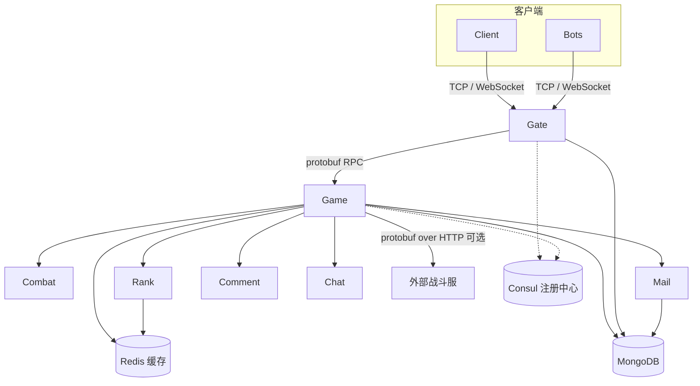
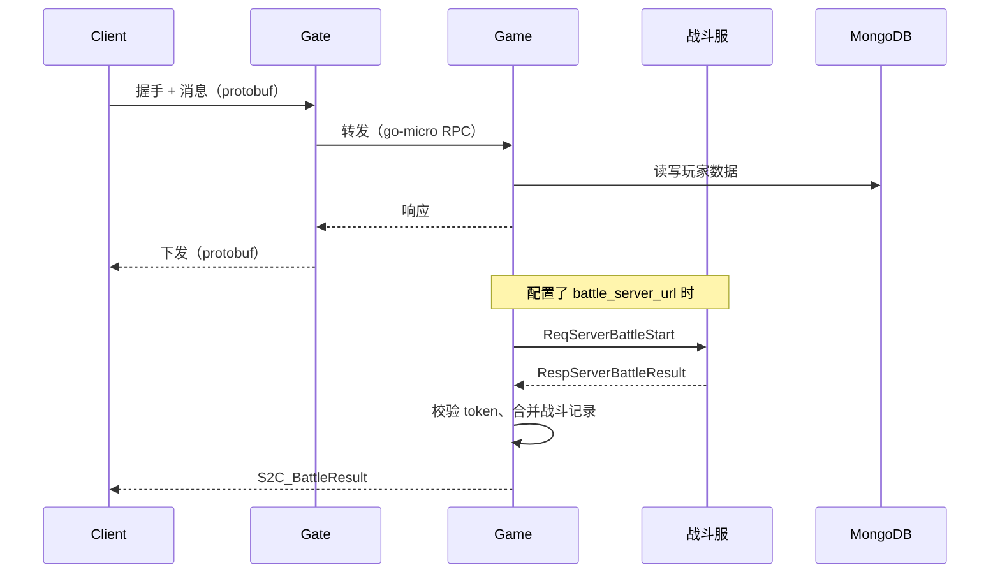
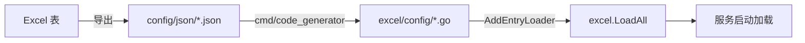

# east-eden/server

[](https://github.com/east-eden/server/actions/workflows/go.yml)
[](https://pkg.go.dev/github.com/east-eden/server)
[](https://goreportcard.com/report/github.com/east-eden/server)

## 简介

`east-eden/server` 是一套可水平扩展、高可用的**卡牌养成类游戏服务端框架**，基于
[go-micro](https://github.com/go-micro/go-micro) v4 构建，服务间使用 protobuf 消息通信，
数据落在 MongoDB，缓存走 Redis，注册中心为 Consul、消息总线为 NSQ。

当前版本在原框架基础上完成了一次以数据驱动为主的架构升级：

- **协议统一为 protobuf**：前后端与服务间通信全部使用 protobuf 消息，报文头为
  `4 字节长度 + 4 字节消息名 CRC32`，不再使用自定义 ts 协议
- **配置改为 Excel/JSON 驱动**：配置表以 `config/json` 为源，由 `cmd/code_generator`
  生成强类型访问代码到 `excel/config`
- **物品体系改为 Goods 账本**：道具按 `Goods` 表定义，堆叠、类型、子类型均由配置决定，
  移除了原有的装备、晶石与代币系统
- **英雄改为卡牌模型**：一个英雄配置对应一张卡，等级/星级/晋升/品质决定属性与战力，
  英雄碎片以 chip 计数形式保存在玩家数据中
- **战斗可外置**：支持把战斗请求以 protobuf 报文 POST 给外部战斗服，并用一次性 token
  与战斗记录合并来校验客户端上报的胜负

## 架构



### 请求链路



## 目录结构

| 目录 | 说明 |
| --- | --- |
| `apps/` | 各服务的可执行入口（gate/game/combat/mail/rank/comment/chat/client/bots） |
| `services/` | 服务实现：网络、玩家逻辑、场景战斗等 |
| `excel/config/` | 由 `config/json` 生成的配置访问代码 |
| `excel/auto/` | 旧版 CSV 配置的访问代码（仍在用，逐步迁移） |
| `config/json/` | 配置表源数据（Excel 导出的 JSON） |
| `config/csv/` | 旧版 CSV 配置 |
| `config/<服务>/config.toml` | 各服务运行配置 |
| `cmd/code_generator/` | 配置代码生成器 |
| `proto/` | protobuf 生成代码（源在独立的 proto 仓库） |
| `internal/` | 内部通用组件（属性公式缓存、优先级队列、一致性哈希、战斗服客户端等） |
| `store/` | MongoDB / Redis 存储层与 protobuf-BSON 编解码 |
| `transport/` | TCP / WebSocket / KCP 传输与消息注册 |

## 环境要求

- **Go 1.22+**
- **MongoDB**
- **Consul**（服务注册，release 模式）
- **NSQ**（消息总线，release 模式）
- 可选：外部战斗服（不配置 `battle_server_url` 时走客户端本地战斗）

## 快速开始

1. 拉取代码（协议仓库需与本仓库同级）：

```shell
git clone https://github.com/east-eden/server.git
git clone https://github.com/east-eden/proto.git
```

2. 启动依赖（MongoDB 等）：

```shell
docker-compose up -d mongo
```

3. 生成配置代码与协议代码：

```shell
go run ./cmd/code_generator -readJsonPath=config/json -exportGoPath=excel/config
make proto PROTO_DIR=../proto
```

4. 启动服务（各自一个终端）：

```shell
cd apps/gate && go run main.go
cd apps/game && go run main.go
cd apps/combat && go run main.go
```

5. 启动调试客户端：

```shell
cd apps/client && go run main.go
```

也可以直接 `docker-compose up -d`，compose 会基于 `apps/*/Dockerfile` 本地构建镜像。

## 服务启动与配置中心

服务启动统一走 `internal/launcher`：

```mermaid
graph TD
    A[进程启动] --> B{启用配置中心?}
    B -->|是| C[Consul KV: config/{app}]
    B -->|否| D[本地 TOML: config/{app}/config.toml]
    C -->|读取失败| D
    C --> E[解析 YAML 得到配置项]
    D --> E
    E --> F{release 且配置 node_id_range?}
    F -->|是| G[Consul 锁抢占节点 id]
    F -->|否| H[使用 {app}_id]
    G --> I[写入注册元数据 nodeId]
    H --> I
```

- **配置来源**：设置 `CONSUL_HTTP_ADDR`（或传 `-config_center`）时从 Consul KV 的
  `[config_center_prefix/]config/<app>` 读取 YAML，读不到自动回退本地 TOML
- **节点 id**：`debug` 模式取 `node_id_range` 最小值，release 模式在范围内通过 Consul
  锁抢占，抢到后写入注册元数据 `nodeId`，并拒绝重复的 `nodeId` 注册
- **凭据**：Consul 的 `CONSUL_HTTP_TOKEN` 只从环境变量读取，代码里没有任何内置 token
- **退出**：进程退出时释放节点 id 锁，让缩容/重启腾出的 id 立即可以复用

## 内部组件（internal）

| 包 | 用途 |
| --- | --- |
| `config_center` | Consul KV 配置读取、TTL 节点 id 锁 |
| `launcher` | 服务启动：配置来源选择、节点 id 分配与释放 |
| `micro_service` | 服务发现选择器（按节点名/节点 id/一致性哈希）与哈希环缓存、RPC 注册表 |
| `att` | 属性聚合器（基础/百分比/最终属性，基于 Att 表） |
| `attrcache` | 属性公式求值与缓存 |
| `battle` | 外部战斗服客户端（protobuf over HTTP） |
| `entity` | 实体快照缓存与增量下发（`$update$` / `$update_clean$`） |
| `timer` | 基于优先队列的计时器管理器 |
| `proto_register` | protobuf 消息处理器注册表 |
| `activity` | 活动开启/结束时间计算（cron / datetime / duration / 创建时间 / 等级） |
| `settle` | 玩家结算数据记录与读取（带过期时间） |
| `cross_server` | 跨服分组（顺序分组 / 蛇形分组） |
| `team_league` | 组队联赛任务构造（普通任务 / 特殊任务） |
| `fkqst` | 骑士团对接 HTTP 客户端（通过 Adapter 接口解耦平台配置） |
| `world_boss` | 世界 boss 期数与下一期开始时间 |
| `consistent` / `pq` / `container` | 一致性哈希、优先队列、容器工具 |

部分包在移植时做了去平台化适配：`entity` 用 `Entity`/`Notifier` 接口替代原有的 ECS 框架依赖，
`fkqst` 通过 `Adapter` 接口获取配置，`activity` 用本地 `ActivityConf` 结构替代 ts 协议结构，
`team_league` 用本地任务结构 + `ToPB` 适配 protobuf。

## 配置管线



- 新增表：把 JSON 放进 `config/json`，运行生成器即可得到 `GetXxxEntry` 等访问函数
- 百分比等特殊列由生成器按字段类型映射，`number` 类型映射为 `decimal.Decimal`
- 生成的枚举复合键使用字段名（如 `<星级>_<品质名>`），手写辅助函数放在 `*_manual.go`

## 协议

- 仓库只使用 **protobuf**，消息定义在独立的 proto 仓库，`make proto` 生成到 `proto/`
- 报文头：`4 字节长度 + 4 字节消息名 CRC32`，消息体为 protobuf 序列化结果
- 新增协议时同步修改 proto 仓库并重新生成，不要手写序列化

## 战斗

- 配置了 `battle_server_url` 时，服务端把 `ReqServerBattleStart` POST 给战斗服并等待
  `RespServerBattleResult`，同时生成一次性校验 token
- 客户端提交 `C2S_BattleResult` 后，服务端校验 token 与战斗服结果，再用 `S2C_BattleResult`
  确认胜负；客户端自报的胜负在服务器战斗模式下会被拒绝
- 未配置战斗服时，走客户端本地战斗的旧流程

## 测试

```shell
make test           # 单元测试
make test_verbose   # 带详细输出
make lint           # go vet
```

## 安全说明

- 仓库**不包含**任何证书与私钥。本地开启 TLS 前先生成自签名证书：

```shell
make cert
```

- 推送镜像需要自行提供凭据，通过环境变量传入，不会写入仓库：

```shell
DOCKER_USER=your-account DOCKER_PASS=your-token make push
```

- 生产环境请使用密钥管理服务下发数据库与第三方凭据，不要提交到仓库

## 文档

- [微服务与数据流结构](docs/organize_graph.md)
- [使用手册](docs/manual.md)
- [TCP 协议](docs/tcp_protocol.md)
- [服务端命令](docs/server_cmd.md)
- [属性定义](docs/att_define.md)

## License

MIT
