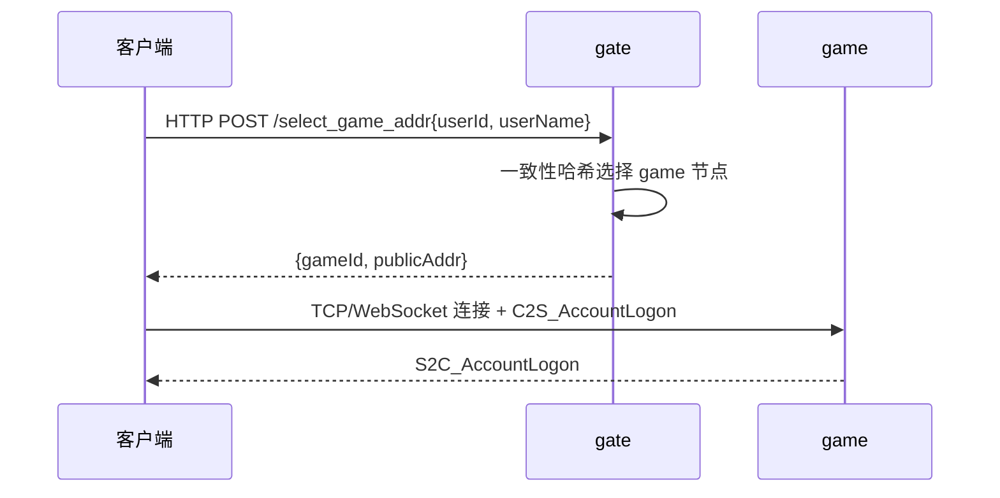
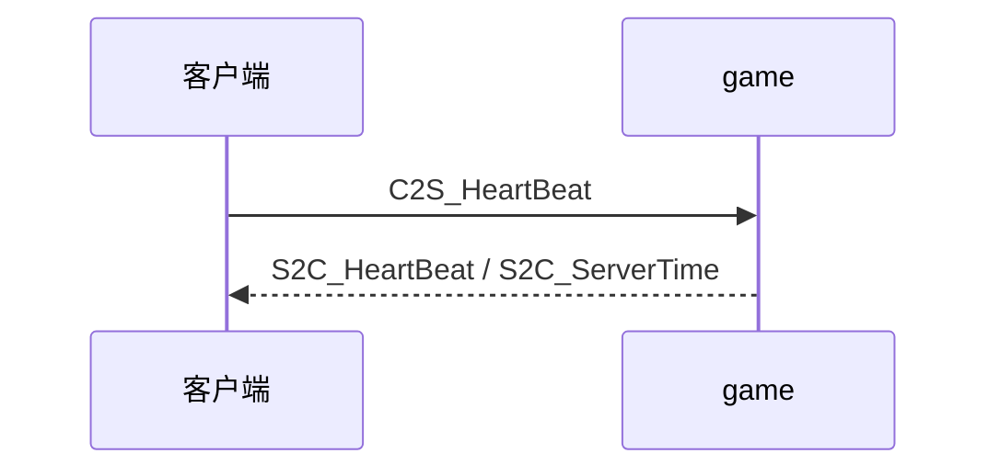

# 客户端连接流程

## 1. 请求游戏服地址

客户端先通过 gate 的 HTTP 接口获取可用的 game 服务地址：

- `gameId` 是该玩家绑定的 game 节点 id（同一玩家稳定命中同一节点）
- `publicAddr` 为 game 对外监听地址

## 2. 登录

连接建立后发送 `C2S_AccountLogon`，game 返回 `S2C_AccountLogon`。首次登录会用账号创建角色。

## 3. 心跳

与服务器建立连接后需要定时发送心跳：

超过 `heart_beat_timeout`（默认 1 分钟，见 `config/game/config.toml`）未收到心跳，服务端会主动断开连接，客户端需要重新建立连接。

## 4. 断线重连

客户端重连时携带原 `gameId` 与 `userId`，gate 会把连接路由回该玩家所在的 game 节点。
